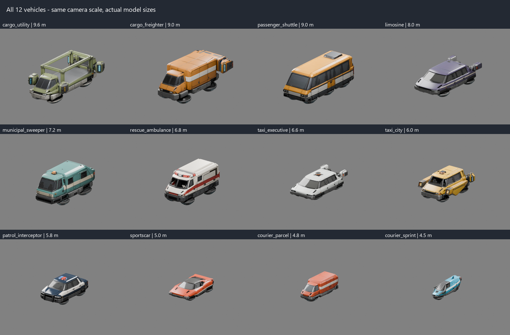
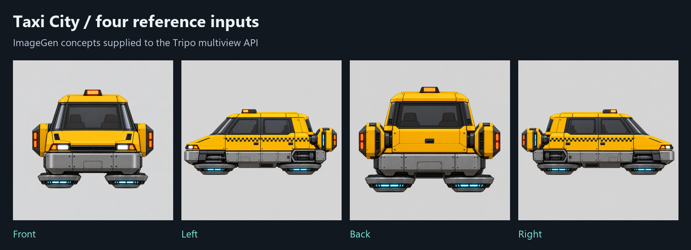
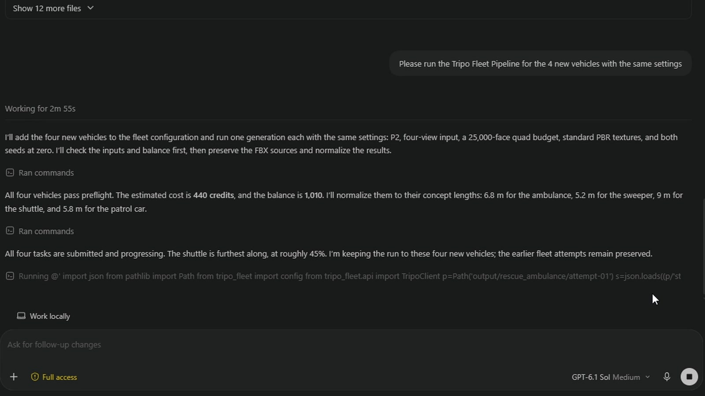
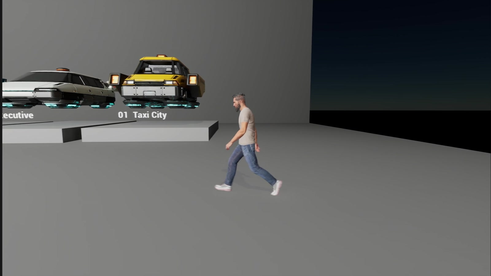

# TripoFleet

**Four reference views in. A fleet of textured hover vehicles out.**

This is the Python tool I built with Codex for Episode 05 of **David Kahl Builds**. It calls Tripo's REST API to generate vehicles, keeps a record of every attempt, and normalizes the models to a shared scale and orientation for my Unreal traffic scene.

**[Watch the episode: From One AI Taxi to 100 Flying Vehicles with Tripo: Build or Generate?](https://www.youtube.com/watch?v=z4d0sXfJWZM)**

The episode compares my GeometryForge pipeline with Tripo: one taxi up close, physical prints, then a city full of background traffic. Tripo sponsored the episode. TripoFleet is my independent companion project; it uses the REST API directly.



*The twelve selected vehicles from the episode. Length is normalized; the generated proportions and visible imperfections are preserved.*

## Start with one taxi

You need **Python 3.11+**, [uv](https://docs.astral.sh/uv/getting-started/installation/), and a Tripo API key with API credits when you decide to generate. For the configured P2 quad output, also install [Blender](https://www.blender.org/download/) for local FBX conversion. GeometryForge and Unreal are optional downstream tools; neither is required to run this repo.

Clone or download this repository, open a terminal in its root, then:

```console
git clone https://github.com/DavidKahl/Tripo-Fleet.git
cd Tripo-Fleet
uv sync --locked
uv run tripo-fleet plan --only taxi_city
uv run tripo-fleet run --only taxi_city
```

These commands validate the included images and preview the job. **`run` is a dry run unless you add `--go`.** No key is needed for these three commands.

Copy `.env.example` to `.env` and set `TRIPO_API_KEY` there, or set it in your environment. Keep `.env` private. Key lookup is: environment, repository `.env`, then a shared `.env` in the parent folder. The API host defaults to `https://openapi.tripo3d.ai/v3`; `TRIPO_API_BASE` can override it through the environment.

For Blender, put `blender` on PATH or set `BLENDER_EXE` to its executable path in your shell. On Windows, for example:

```powershell
$env:BLENDER_EXE = "C:\Program Files\Blender Foundation\Blender 5.2\blender.exe"
```

Once you have reviewed the plan and are ready to spend API credits:

```console
uv run tripo-fleet balance
uv run tripo-fleet run --only taxi_city --go
uv run tripo-fleet report
```

`balance` only queries the wallet. Generation uploads the four images, submits one task, polls it, downloads the result, and normalizes it. Start with one vehicle and inspect its orientation before running the fleet.

## The workflow, in pictures

### 1. Prepare consistent views



The [concept gallery](concepts/index.html) contains the four input images for each of the twelve vehicles. Open it locally in a browser. The CLI discovers `front`, `left`, `back` and `right` in `concepts/<vehicle-id>/`. Front is required, with at least two views in total. This client validates PNG/JPEG inputs of at least 256 px per side and at most 20 MiB. Top and bottom views are not submitted.

### 2. Review the plan, then submit deliberately

```console
uv run tripo-fleet plan --balance
uv run tripo-fleet run --only taxi_city --go
uv run tripo-fleet run --parallel 3 --go
```

The last command generates every configured vehicle that does not already have a completed local result. The episode configuration uses `P2-20260801`, PBR textures, `quad=true`, a requested 25,000-face budget, standard texture quality, and seeds of zero. The CLI's **110 credits per job is an estimate based on this workflow**, not a live price quote; actual consumption comes from the returned task record. Check current pricing in the [Developer Platform](https://developers.tripo3d.ai/).

### 3. Keep the result and the evidence



Each submission gets a new attempt folder. Original downloads, conversion inputs, normalization settings and failures stay available for inspection. Completed vehicles are skipped; `--force` explicitly requests a fresh paid attempt. The [episode run summary](docs/episode-runs.md) explains measured costs, the locally recovered conversion error and the failed generation attempt.

```text
output/
  ledger.jsonl
  report.md
  taxi_city/attempt-01/
    state.json, request.json, task-result.json
    raw.fbx or raw.glb, preview.*
    converted.glb, fbx-inspection.json, conversion.log  # FBX path
    fbx-textures/                                    # FBX path
    taxi_city_tripo.glb, normalize.json, textures/
```

`output/` is entirely ignored by Git: raw task responses can contain signed download URLs, and requests contain uploaded-file tokens. Selected documentation images and sanitized measurements live under `docs/` instead. Model downloads are not included in this source repository.

### 4. Inspect and use the normalized model



The GLB contract is **metres, +Y up, +Z forward, centered pivot**. A uniform scale sets `length_m` from `fleet.json` and preserves the generated width and height. Normalization extracts PBR textures and creates a DirectX normal-map variant for Unreal. Requested native polygon counts and exported GLB triangle counts are reported separately.

Import the normalized GLB into your own viewer or engine and check orientation, dimensions, materials and silhouette. The showroom, traffic logic and GeometryForge catalog shown in the episode belong to separate projects. This repo generates assets; it does not include or create that Unreal scene. See [the workflow guide](docs/workflow.md) for material channels and integration details.

## Recover, customize, learn

| Task | Command |
|---|---|
| Validate all input views without a key | `uv run tripo-fleet plan` |
| Finish an existing task without a new generation | `uv run tripo-fleet resume --only taxi_city` |
| Reapply scale/orientation to downloaded files locally | `uv run tripo-fleet normalize --only taxi_city` |
| Export your own measurements | `uv run tripo-fleet report --json output/report.json` |
| Use another configuration/output directory | `uv run tripo-fleet --fleet my-fleet.json --output my-output plan` |
| Run the offline test suite | `uv run pytest` |

Global `--fleet` and `--output` flags go **before** the subcommand. Keep custom output directories out of Git too. `normalize` rewrites derived models and texture files; original API downloads remain the source. `resume` polls and downloads existing task IDs rather than submitting another generation.

To use your own designs, add a vehicle folder with matching views and edit `fleet.json`. The episode fleet is ready to use without running `init`. The optional `init --recipe path/to/recipe.json` command imports a GeometryForge recipe if you have one.

- [How the API client and runner fit together](docs/how-it-works.md)
- [Detailed workflow and troubleshooting](docs/workflow.md)
- [Measured episode results, including failures](docs/episode-runs.md)
- [Tripo's P-series multiview API documentation](https://developers.tripo3d.ai/en/docs/generation-multiview-to-model/p)

## License

**Use this freely, including commercially.** The code, configuration and written documentation are [MIT licensed](LICENSE). The included reference images and David's rights in screenshots/renders are dedicated to the public domain under [CC0](licenses/CC0-1.0.txt): copy, change, redistribute or sell them without asking permission or giving attribution.

**Whatever you create with the tool is yours to use.** David claims no rights in your outputs and requires no royalties, attribution, approval or source-code release for them. Tripo's service terms and rights in third-party inputs still apply. See [ASSETS.md](ASSETS.md) for the full permission statement. This source-code companion does not include the twelve-vehicle download pack.
