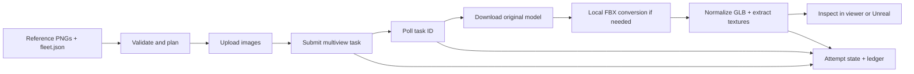

# How I built the API workflow

The episode needed varied background vehicles that fit an existing traffic scene. I kept the fleet contract in JSON and split the tool into a small HTTP client, a resumable runner, and local GLB processing. Codex helped build the tool; input views, vehicle sizes, acceptable defects and attempt selection stayed part of my production review.



## Read the code in this order

| File | Responsibility |
|---|---|
| [`fleet.py`](../src/tripo_fleet/fleet.py) | Finds views, validates images, merges settings, builds the payload. Only recognized generation fields pass through. |
| [`api.py`](../src/tripo_fleet/api.py) | Authenticated requests, uploads, task creation and polling; unauthenticated streaming downloads from signed result URLs. |
| [`runner.py`](../src/tripo_fleet/runner.py) | Attempt folders, progress, state files, ledger, conversion, normalization and recovery of known tasks. |
| [`blender_fbx.py`](../src/tripo_fleet/blender_fbx.py) | Runs inside Blender: imports FBX, records polygon counts, retains packed images and exports GLB. |
| [`gltf_norm.py`](../src/tripo_fleet/gltf_norm.py) | Orientation, scale, pivot and texture extraction. Bakes transforms when safe; records a root-transform fallback otherwise. |
| [`report.py`](../src/tripo_fleet/report.py) | Reads attempt state and normalization reports into a table and optional JSON. |
| [`cli.py`](../src/tripo_fleet/cli.py) | User commands, explicit spending gate and bounded parallel jobs. |

## The HTTP sequence

The client talks to `https://openapi.tripo3d.ai/v3`:

1. `POST /files` uploads each image as multipart field `file` and returns a file token.
2. `POST /generation/multiview-to-model` submits view tokens and settings, returning a task ID.
3. `GET /tasks/{task_id}` polls until a terminal status.
4. A successful task provides a model URL. The runner downloads the model and preview promptly, before the signed URLs expire.
5. `GET /account/balance` is a separate, read-only wallet check.

See [Tripo's official P-series reference](https://developers.tripo3d.ai/en/docs/generation-multiview-to-model/p) and [file-upload reference](https://developers.tripo3d.ai/en/docs/files) (checked 2026-11-01). The implementation is a small `requests` client; it does not shell out to the official Tripo CLI.

The payload looks like this; these strings are illustrative placeholders, not usable tokens:

```json
{
  "inputs": [
    {"front": "<uploaded-front-file-token>"},
    {"left": "<uploaded-left-file-token>"},
    {"back": "<uploaded-back-file-token>"},
    {"right": "<uploaded-right-file-token>"}
  ],
  "model": "P2-20260801",
  "texture": true,
  "pbr": true,
  "quad": true,
  "face_limit": 25000,
  "texture_quality": "standard",
  "model_seed": 0,
  "texture_seed": 0
}
```

## Why the runner keeps attempts

Generation creation has no idempotency key in this client. Automatically retrying an ambiguous submission could create a second paid task. The client retries selected transient failures for GETs and uploads, but **never automatically retries generation submission**. If the response was lost before a task ID was saved, inspect the Developer Platform before submitting again. `resume` needs a known task ID.

API success also does not mean local delivery succeeded. A model still needs downloading, conversion if appropriate, and normalization. The skip check requires both a success record and a normalized file. An interrupted known task can be polled again with `resume`; a failed generation needs a deliberate new run.

The original courier attempt illustrates this distinction: the API charged for a successful task, but local GLB loading initially failed. That attempt was recovered through local FBX conversion; a later 25,000-face attempt supplied the selected model. See [the measurements and caveats](episode-runs.md).

## Why normalize locally

The traffic scene expects consistent units, forward direction and pivot placement. A uniform length scale preserves generated proportions. The tool retains the original model and writes the transform, dimensions, triangle count and warnings to `normalize.json`. FBX conversion runs locally in Blender, without an extra paid API conversion.

The configured source forward axis is `+x`; the delivered GLB is +Z forward and +Y up. A generated shape can still be misoriented or visually poor, so inspection remains necessary. Native polygons differ from triangles after export, and the requested face budget can be exceeded in the observed outputs.
