# Download the twelve-vehicle pack

**[GLB download](https://github.com/DavidKahl/Tripo-Fleet/releases/download/vehicle-pack-v1.0.0/TripoFleet-Vehicles-GLB-v1.0.0.zip)** — self-contained models with embedded PBR textures.

**[FBX + PBR download](https://github.com/DavidKahl/Tripo-Fleet/releases/download/vehicle-pack-v1.0.0/TripoFleet-Vehicles-FBX-PBR-v1.0.0.zip)** — native quad/mixed-polygon models, companion texture folders and separate PBR maps.

**[All release files and checksums](https://github.com/DavidKahl/Tripo-Fleet/releases/tag/vehicle-pack-v1.0.0)**

No API key, Python install or generation credits are needed to use the pack. While this repository is private, the release downloads require repository access.

Models, textures and preview renders are offered under [CC0](../licenses/CC0-1.0.txt), for free personal and commercial use, including modification, redistribution and sale, with no attribution required by David. See [the permissions statement](../ASSETS.md).

## All twelve vehicles

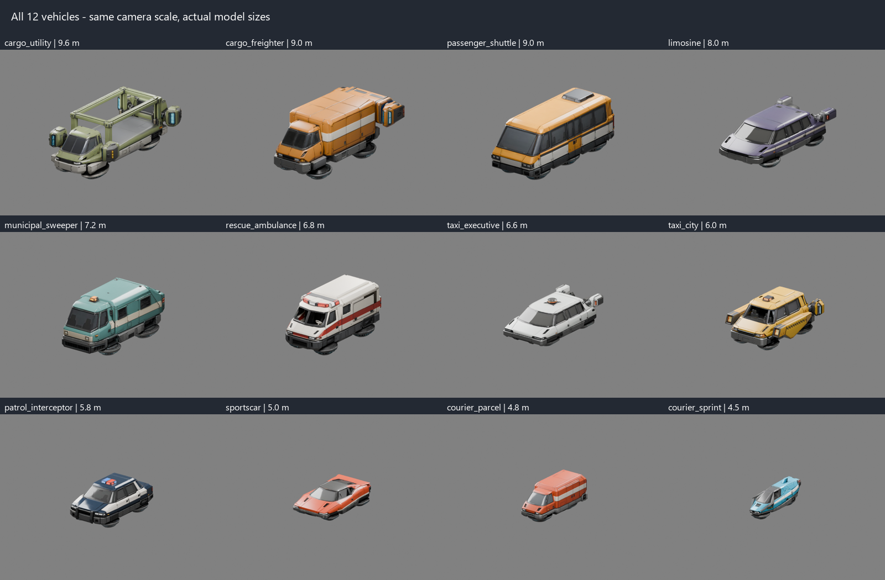

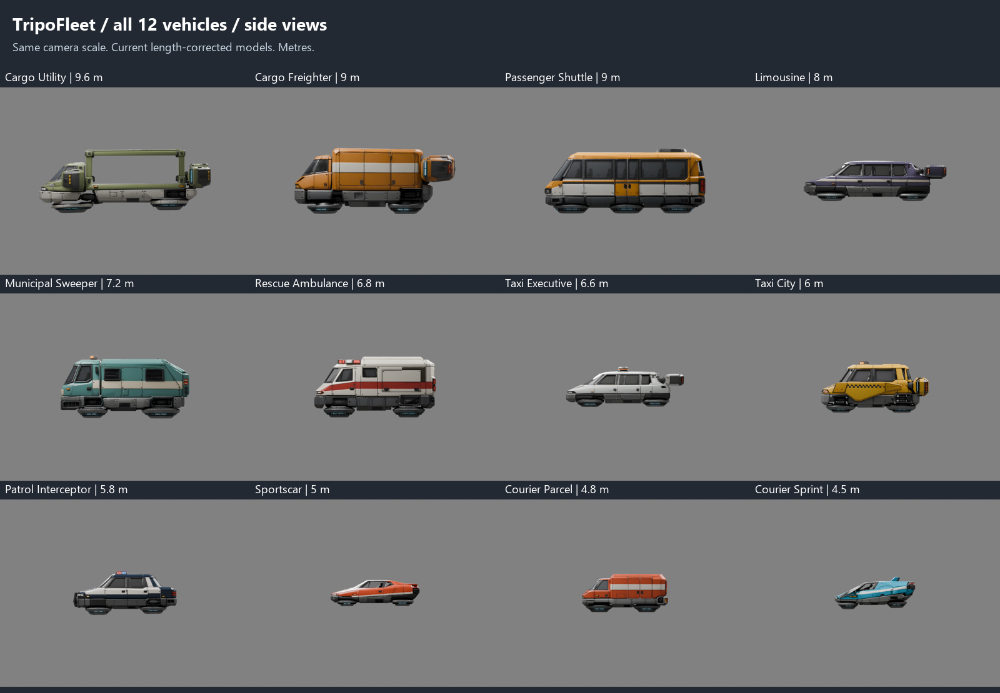

| Vehicle | Length x width x height (m) | GLB triangles |
|---|---:|---:|
| Cargo Utility (`cargo_utility`) | 9.60 x 5.03 x 3.58 | 48,711 |
| Cargo Freighter (`cargo_freighter`) | 9.00 x 5.12 x 3.70 | 49,105 |
| Passenger Shuttle (`passenger_shuttle`) | 9.00 x 3.47 x 3.64 | 52,448 |
| Limousine (`limosine`) | 8.00 x 4.12 x 2.25 | 48,655 |
| Municipal Sweeper (`municipal_sweeper`) | 7.20 x 4.00 x 3.52 | 51,372 |
| Rescue Ambulance (`rescue_ambulance`) | 6.80 x 3.44 x 3.40 | 45,900 |
| Taxi Executive (`taxi_executive`) | 6.60 x 3.39 x 2.23 | 44,310 |
| Taxi City (`taxi_city`) | 6.00 x 4.25 x 2.87 | 46,937 |
| Patrol Interceptor (`patrol_interceptor`) | 5.80 x 3.26 x 2.44 | 48,952 |
| Sportscar (`sportscar`) | 5.00 x 3.15 x 1.46 | 44,008 |
| Courier Parcel (`courier_parcel`) | 4.80 x 2.07 x 2.13 | 45,533 |
| Courier Sprint (`courier_sprint`) | 4.50 x 1.66 x 1.81 | 48,065 |

## Individual vehicle previews

| Vehicle | Preview |
|---|---|
| **Cargo Utility** `cargo_utility` 9.6 m long | 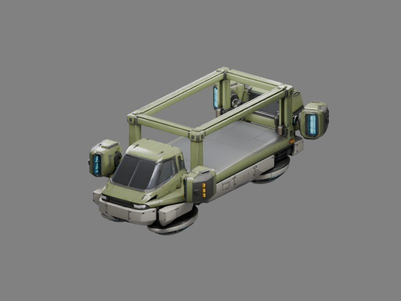 |
| **Cargo Freighter** `cargo_freighter` 9 m long | 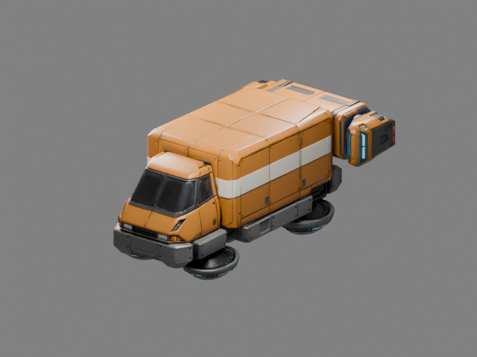 |
| **Passenger Shuttle** `passenger_shuttle` 9 m long | 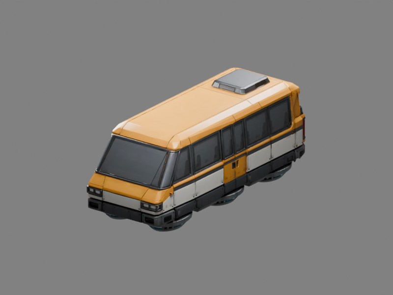 |
| **Limousine** `limosine` 8 m long | 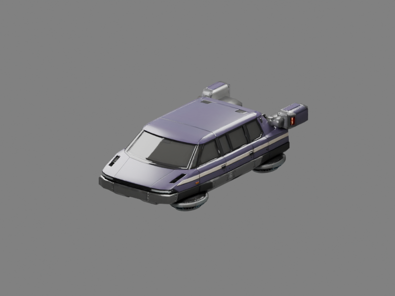 |
| **Municipal Sweeper** `municipal_sweeper` 7.2 m long | 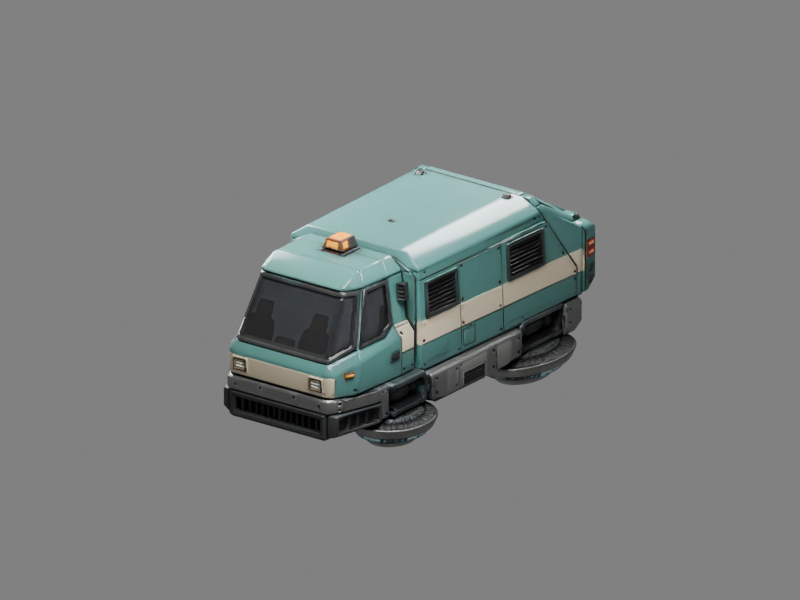 |
| **Rescue Ambulance** `rescue_ambulance` 6.8 m long | 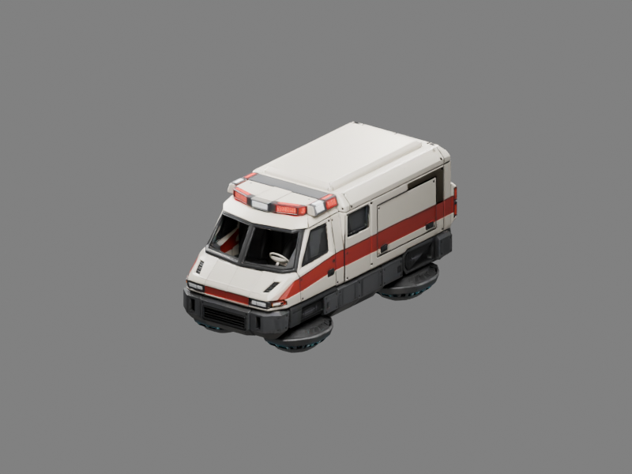 |
| **Taxi Executive** `taxi_executive` 6.6 m long | 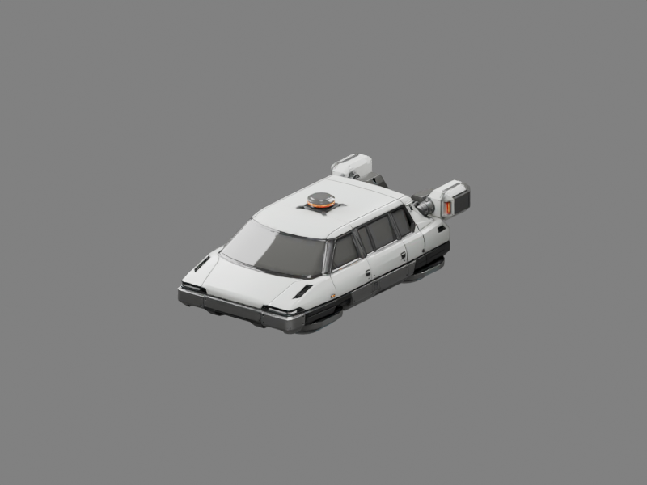 |
| **Taxi City** `taxi_city` 6 m long | 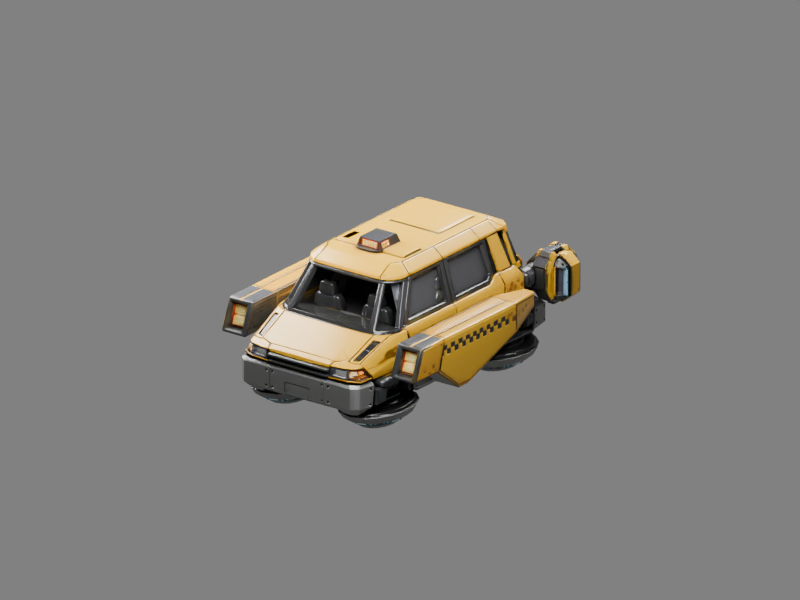 |
| **Patrol Interceptor** `patrol_interceptor` 5.8 m long | 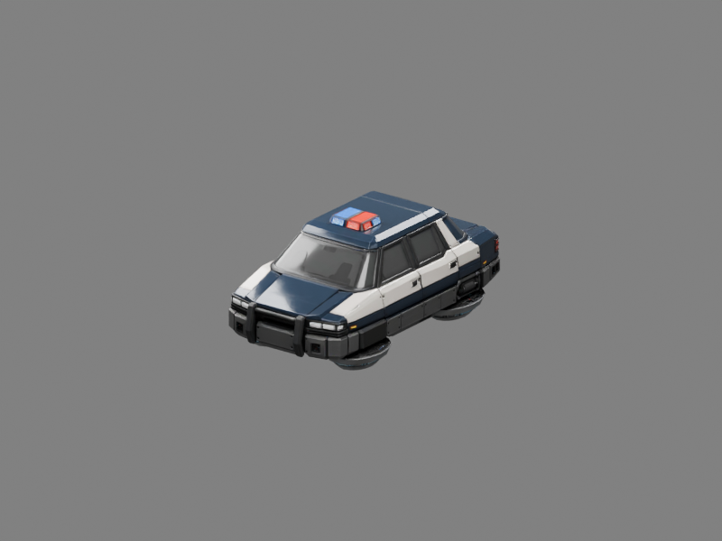 |
| **Sportscar** `sportscar` 5 m long | 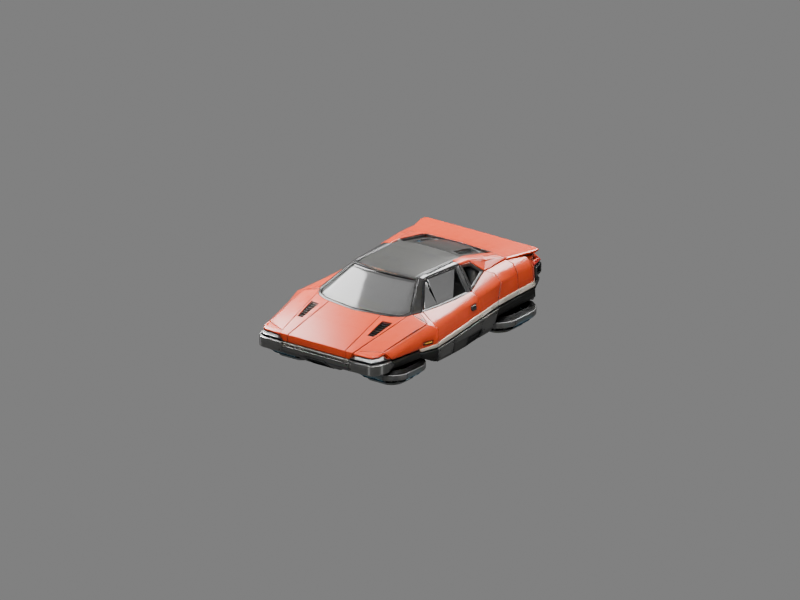 |
| **Courier Parcel** `courier_parcel` 4.8 m long | 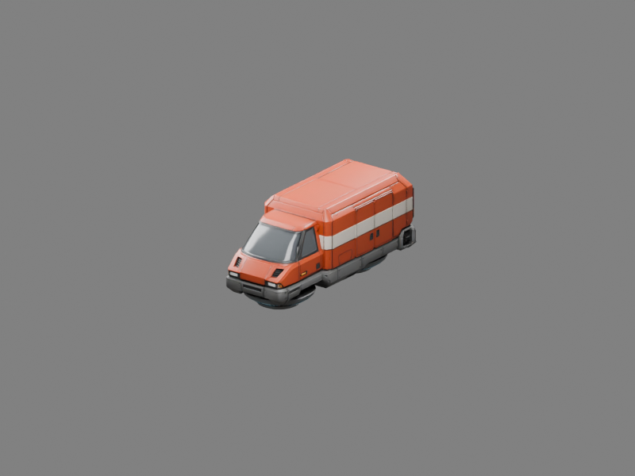 |
| **Courier Sprint** `courier_sprint` 4.5 m long | 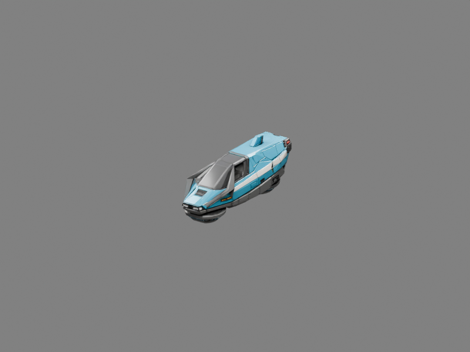 |

## What you receive

Both ZIPs include all twelve vehicles, the two vehicle-list images, CC0 license, import instructions and a manifest of file hashes. The GLBs are in metres, +Y up and +Z forward with centered pivots and embedded textures. The FBXs retain native +X nose orientation and native quad/mixed topology; their axis metadata is handled by the importer. Companion `textures/` folders and separate `pbr/` maps are included with the FBXs.

The current 7.2 m sweeper and selected courier attempt are used. Historical attempts are preserved locally, outside the downloads. The generated shapes and imperfections are unchanged. This is an asset pack; the Unreal traffic scene is a separate project.

For material channels and engine conventions, see [the workflow guide](workflow.md). [The sanitized model manifest](vehicle-pack-manifest.json) lists dimensions, native polygon counts and GLB/FBX hashes. No API task responses, file tokens, signed download URLs, credentials or production logs are included.
